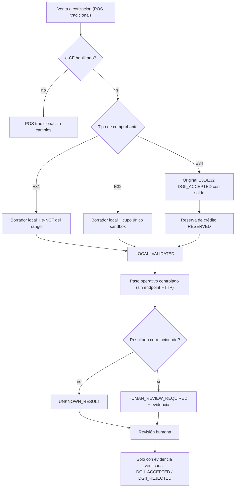

# e-CF (Alanube / DGII) — Integración en la aplicación y guía operativa

Estado: **implementación local verificada** (2026-10-15). La certificación externa
(sandbox y producción DGII) **no** forma parte de este documento: sigue pendiente y
requiere autorización y ejecución humana.

Worktree: `FULLPOS-ECF-ALANUBE`, rama `feature/ecf-alanube`. Nada de esto se ha
confirmado (`commit`), desplegado ni ejecutado contra producción.

---

## 1. Principio rector

| Regla | Consecuencia práctica |
| --- | --- |
| HTTP 200/201 ≠ aceptación fiscal | Una respuesta del proveedor nunca se traduce en `DGII_ACCEPTED`. |
| La observación del proveedor ≠ validación de la DGII | Toda observación correlacionada queda en `HUMAN_REVIEW_REQUIRED`. |
| Un número consumido no se reutiliza | `EcfSequence.nextNumber` solo incrementa; hay guarda a nivel de base de datos. |
| Sin evidencia no hay aceptación | Las transiciones a `DGII_ACCEPTED`/`DGII_REJECTED` exigen evidencia verificada. |
| e-CF está apagado por defecto | `EcfCompanyConfiguration.enabled = false` en toda empresa nueva. |

---

## 2. Manual de configuración e-CF

### 2.1 Requisitos previos (por empresa)

1. RNC y datos fiscales del emisor correctos en la configuración de la empresa.
2. Certificado digital y credenciales Alanube registradas (`credentialsSecretRef`,
   `certificateSecretRef`). **Las referencias se guardan como referencias, nunca
   el secreto en claro.**
3. Rango de numeración e-NCF vigente para E31 y/o E34.
4. Pasos de onboarding completados (`/ecf/onboarding`): requisitos, configuración
   fiscal, certificado, registro Alanube, postulación DGII, firma XML, pruebas SET,
   simulaciones, representación impresa, URLs de servicio, declaración jurada,
   autorización final, solicitud de e-NCF y habilitación de producción.

### 2.2 Habilitar en la aplicación

- Pantalla **Configuración e-CF** (`/ecf/config`) → interruptor *Habilitar
  facturación electrónica*.
- Requiere el permiso `manageEcfConfig`.
- El interruptor **solo** cambia la configuración: no emite, no consume secuencias
  y no contacta al proveedor.
- Ambiente y estado de certificación se muestran en la misma pantalla.

### 2.3 Rangos de numeración

- Se consultan en `/ecf/sequences`. Cada rango muestra consumidos y disponibles.
- Un rango nuevo (`register`) es el primero de la empresa para ese tipo; uno
  posterior se aplica con `renew`.
- `renew` **no** puede empezar por debajo del frente ya consumido
  (`ECF_SEQUENCE_REUSE_BLOCKED`).
- E32 no usa rango: mantiene su cupo de un solo uso (`FIRST_E32_SANDBOX`).

---

## 3. Flujo E31 / E32 / E34



- **E31** — comprobante de crédito fiscal. Consume el rango de la empresa.
- **E32** — consumidor final. Reservado al cupo de un solo uso del sandbox; nunca
  se asigna desde el rango.
- **E34** — nota de crédito sobre un original elegible. Exige reserva `RESERVED`
  del mismo `originalDocumentId` antes de cualquier despacho; la reserva se
  mantiene ante rechazo, timeout o resultado desconocido.
- **Notas parciales y totales**: el saldo disponible lo calcula la política fiscal
  compartida del backend (`EcfE34CreditService.balance`); una nota que exceda el
  saldo se rechaza con `E34_INSUFFICIENT_FISCAL_BALANCE`.

### 3.1 Preparación desde una venta (implementado)

`POST /ecf/documents/prepare` (permiso `prepareEcfDocuments`) crea un **borrador
local** a partir de una venta real, mediante `EcfSaleFiscalAdapter`:

- lee la venta desde PostgreSQL y la filtra por empresa;
- exige emisor completo (nombre, RNC, dirección) y, para E31, receptor identificado;
- deriva la categoría fiscal de `SaleItem.taxRate` / `taxExempt` y **rechaza**
  cualquier tasa no soportada en lugar de aproximarla;
- deriva bien/servicio de `Product.itemType`;
- calcula el **precio unitario sin impuesto** y verifica que
  `cantidad × unitPrice − descuento` reproduzca la base neta persistida;
- comprueba que las partidas y los totales de la venta no se contradigan;
- asigna el e-NCF del rango de la empresa (E31) y persiste el borrador.

Preparar **no** es emitir: no hay red, no hay proveedor y el estado queda en
`LOCAL_VALIDATED`. Si falta cualquier dato obligatorio devuelve un error
estructurado y **no** se crea ningún documento.

Solo **E31** se prepara desde una venta. E32 usa su cupo de un solo uso y E34 se
prepara como nota de crédito sobre un original elegible.

### 3.2 Lo que la aplicación **no** hace

- **No emite.** No existe ningún endpoint HTTP que invoque el envío al proveedor.
  `capabilities.emissionPathAvailable` es `false` y la interfaz no ofrece acción
  de emisión. La emisión es un paso operativo controlado con las banderas de
  seguridad activas.
- **No promueve estados fiscales.** La aplicación escribe únicamente el
  interruptor de configuración; todos los demás estados los decide el backend.

---

## 4. Procedimiento de pruebas

### 4.1 Backend (base de datos efímera, proveedor simulado)

```powershell
# 1. Base de datos efímera (puerto 56551, jamás la UAT histórica del 56550)
pwsh scripts/ecf-test-db/up.ps1
pwsh scripts/ecf-test-db/reset.ps1        # reconstruye el esquema desde prisma/migrations
pwsh scripts/ecf-test-db/migrate.ps1

# 2. Suite completa + verificación de aislamiento de la UAT histórica
pwsh scripts/ecf-test-db/run-tests.ps1

# 3. Suites e-CF concretas
pwsh scripts/ecf-test-db/run-focused.ps1 -Pattern "ecf-e31-emission-postgres"
pwsh scripts/ecf-test-db/run-focused.ps1 -Pattern "ecf-e34-emission-postgres"
pwsh scripts/ecf-test-db/run-focused.ps1 -Pattern "ecf-sequence-postgres"
pwsh scripts/ecf-test-db/run-focused.ps1 -Pattern "ecf-document-query-postgres"
```

`run-tests.ps1` falla si la UAT histórica cambia: imprime y compara
`(companies, trials, documents)`; la línea base verificada es **708 / 568 / 3462**.

### 4.2 Aplicación Flutter

```powershell
cd apps/fulltech_app
flutter pub get
flutter analyze
flutter test
flutter test test/features/ecf
```

### 4.3 Reglas de la prueba

- Solo PostgreSQL **efímera** y transporte **simulado**. Nunca el proveedor real.
- Nunca la UAT histórica ni el comprobante `E320009805001`.
- Los datos son sintéticos; los e-NCF de prueba no se reutilizan entre suites.

---

## 5. Checklist Alanube

- [ ] Contrato DOM por tipo documental en `CONFIRMED_OFFICIAL` (ver
  `/ecf/capabilities` → `contractStatus`). E32 sigue en `PARTIAL_OFFICIAL`.
- [ ] Credenciales y certificado resueltos por referencia (`secretRef`).
- [ ] Endpoints oficiales confirmados por el proveedor (matriz de contrato).
- [ ] Idempotencia del proveedor confirmada.
- [ ] Firma de webhook confirmada (pendiente de confirmación del proveedor).
- [ ] Mapeo de estados de respuesta documentado y probado.
- [ ] Sin llamadas reales mientras `ALANUBE_ENABLE_REAL_CALLS=false`.

## 6. Checklist DGII

- [ ] RNC del emisor y del receptor válidos y coherentes con el payload.
- [ ] e-NCF con el formato `^E(31|34)\d{10}$` para E31/E34.
- [ ] Tipos documentales permitidos por la empresa (`allowedTypes`).
- [ ] Secuencia vigente (no expirada) y con capacidad disponible.
- [ ] Representación impresa (PDF) conforme.
- [ ] Declaración jurada y autorización final registradas en el onboarding.
- [ ] **Ningún** comprobante marcado `DGII_ACCEPTED` sin evidencia verificada.

## 7. Checklist de producción

- [ ] `enabled` activado **deliberadamente** por empresa (por defecto está apagado).
- [ ] `environment = PRODUCTION` y `productionEnabled = true` solo tras la
  autorización externa.
- [ ] `certificationStatus = AUTHORIZED_SANDBOX` como mínimo; producción exige su
  propio estado.
- [ ] Banderas de seguridad revisadas: transporte, llamadas reales, diagnóstico y
  emisión.
- [ ] Respaldo de base de datos y de la configuración fiscal.
- [ ] Usuarios con `viewEcfDocuments`, `manageEcfConfig`, `manageEcfSequences`
  únicamente los necesarios.
- [ ] Plan de rollback revisado y probado en UAT.
- [ ] Aislamiento multiempresa verificado (suite de aislamiento en verde).

## 8. Plan de rollback

| Nivel | Acción | Efecto |
| --- | --- | --- |
| 1 | Desactivar `enabled` de la empresa afectada | La empresa deja de preparar/emitir; los comprobantes existentes se conservan. |
| 2 | Desactivar la bandera de emisión | Bloquea el despacho manteniendo la consulta de estados. |
| 3 | Desactivar el transporte del proveedor | Ninguna llamada real puede salir. |
| 4 | Revertir el despliegue de la aplicación | Se vuelve a la versión previa; la venta tradicional nunca dependió de e-CF. |

- **No** se borran comprobantes, evidencias, reservas ni secuencias: son el
  registro fiscal. Un número consumido permanece consumido.
- La reversión de esquema se evita: las migraciones e-CF son **aditivas**. Si se
  necesitara, se aplica en orden inverso y solo con autorización expresa.

## 9. Riesgos pendientes

| Riesgo | Estado |
| --- | --- |
| Preparación E31 desde venta | **Implementada** (`POST /ecf/documents/prepare`), con adaptador verificado. E32 va por su flujo de sandbox y E34 por notas. |
| ~~Snapshot de `itemType` por partida~~ | **Resuelto.** Migración aditiva `SaleItem.item_type_snapshot`; el adaptador lee el valor congelado y solo cae al producto actual en ventas anteriores a la migración. |
| Nota de crédito E34 | **Implementada.** `POST /ecf/documents/prepare-credit-note` reserva crédito fiscal SIN tocar inventario, caja, turnos ni pagos, y crea un borrador. Clasificación y precio provienen siempre del original. |
| Consumo E32 | **Preparación local implementada.** `POST /ecf/documents/prepare-consumo` crea un borrador SIN numeración: E32 conserva su cupo único de sandbox. La emisión sigue bloqueada por el contrato `PARTIAL_OFFICIAL`. |
| Persistencia del comprobante preparado | **Resuelto.** `fiscal_document` guarda el documento completo; la huella se reproduce desde él y no puede cambiar (trigger `ECF_FISCAL_DOCUMENT_IMMUTABLE`). Los documentos anteriores quedan en `NULL` y siguen funcionando. |
| Bandeja: estados reales | **Resuelto.** `ecf_status_presentation.dart` traduce los 14 estados persistidos; una aceptación del proveedor nunca se presenta como aceptación de la DGII. |
| Sin endpoint de emisión | **Intencional.** Es la garantía de que ningún clic de la aplicación puede emitir. |
| Contrato E32 `PARTIAL_OFFICIAL` | Pendiente de confirmación del proveedor. |
| Webhook sin confirmar | Pendiente de confirmación del proveedor. |
| Certificación DGII sandbox/producción | **No ejecutada.** Requiere autorización y ejecución humana. |
| Asistente de nota de crédito (UI E34) | **Implementado** (`ecf_credit_note_action.dart`): muestra el original y su saldo, permite total/parcial, valida las líneas y exige motivo; el servidor decide clasificación y precio. |
| Auditoría de seguridad | Revisión interna del agente, no un pentest externo. |
