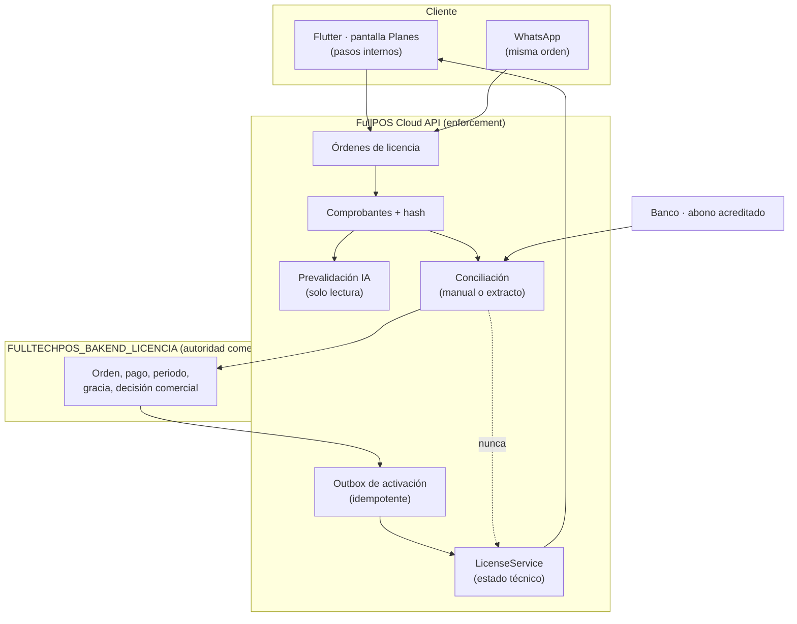

# Plan maestro de implementación (propuesta)

Base: `production-main` @ `6b3e38ed` · rama `agent/planes-de-pago-20261116`.
Fuente de criterios: [`00-estudio-informe-original.md`](./00-estudio-informe-original.md).
Estado del código: [`01-inventario-tecnico-verificado.md`](./01-inventario-tecnico-verificado.md).

> **Este documento es una propuesta, no una autorización.** El informe original exige decisiones de
> negocio ([`03-decisiones-pendientes.md`](./03-decisiones-pendientes.md)) antes de tocar catálogo,
> precios, cuenta bancaria o política de gracia.

---

## 0. Principio rector

Se automatiza **todo lo que no decide dinero** (recepción, extracción, clasificación, comunicación,
seguimiento) y se deja **humano o bancario** lo que sí lo decide (activación definitiva). Nada de la
IA, ni del cliente, puede cambiar el estado de pago.

## 1. Arquitectura objetivo

**Fronteras que no se rompen:**

1. FullPOS **no** inventa precios ni periodos: los recibe del catálogo vigente aprobado.
2. FullPOS **no** marca un pago como acreditado por una imagen: solo lo hace la conciliación.
3. La administración comercial **no** cambia el enum técnico sin pasar por el servicio de licencia.
4. WhatsApp **no** tiene base propia: escribe sobre la misma orden.

## 2. Modelo de datos mínimo (no crear todo lo del informe)

> **Catálogo**: los planes, precios y beneficios **no** se definen aquí. Salen de
> [`04-catalogo-oficial-planes.md`](./04-catalogo-oficial-planes.md), que reproduce lo publicado en
> la web: Básico 1.000 · Negocio 2.000 · Pro 3.000 · Empresa 4.500, todos **al mes**.

El informe lista seis familias de estados y avisa de no crear tablas a ciegas. Propuesta mínima para
FullPOS, **reutilizando** `Company` + `CompanyLicenseAuditLog`:

| Tabla nueva | Campos clave | Por qué |
| --- | --- | --- |
| `LicensePaymentOrder` | `id`, `companyId`, `planCode`, `catalogVersion`, `currency` (DOP), `amount`, `periodStart`, `periodEnd`, `status` (`CREATED`…`EXPIRED`), `reference` (única), `expiresAt`, `createdBy`, `createdAt` | Orden única e inmutable (paso 2 del informe) |
| `LicensePaymentEvidence` | `id`, `orderId`, `channel` (`APP`/`WHATSAPP`), `storageKey`, `mime`, `size`, `sha256`, `status`, `extraction` (JSON), `confidence`, `uploadedBy`, `createdAt` | Comprobante + deduplicación + extracción |
| `LicenseSettlement` | `id`, `orderId`, `source` (`MANUAL`/`BANK_FILE`/`BANK_API`), `bankReference`, `creditedAt`, `amount`, `matchedBy`, `actor`, `createdAt` | **Prueba de dinero** separada del voucher |
| `LicenseActivationJob` | `id`, `orderId`, `state` (`PENDING_SYNC`/`APPLIED`/`RETRYING`/`FAILED_REQUIRES_ATTENTION`), `attempts`, `lastError`, `appliedAt` | Outbox: «acreditado, activación pendiente» |
| `LicenseGracePeriod` | `id`, `companyId`, `reason`, `actor`, `startsAt`, `endsAt`, `revokedAt`, `notes` | Gracia **sin** tocar estado de pago |
| `LicensePlanCatalog` | `code`, `name`, `version`, `monthlyPrice`, `minMonths`, `limits` (JSON), `active`, `effectiveFrom` | Una sola verdad de catálogo, versionada |

Reglas de datos:
- `amount` en **Decimal**, moneda única **DOP** (evitar el defecto USD detectado en el informe).
- `reference` única por empresa y **generada en servidor**; nunca enviada por el cliente como verdad.
- `sha256` único por empresa para detectar reenvío exacto; **no** bloquea capturas distintas del
  mismo pago (se concilia por movimiento bancario).

## 3. Fases

### Fase 0 — Decisiones y entorno (sin código de producto)

**Objetivo:** desbloquear lo que no puede decidir el agente.

- **Recrear la rama desde `origin/production-main`**: la base actual (`6b3e38ed`) está 399 commits
  por detrás y no contiene `website/`. Sin esto, cualquier código nace desfasado.
- Responder [`03-decisiones-pendientes.md`](./03-decisiones-pendientes.md) empezando por C-1
  (almacenes de Pro/Empresa) y C-2 (qué es «mayor capacidad de facturación»).
- Fijar el catálogo servidor desde [`04-catalogo-oficial-planes.md`](./04-catalogo-oficial-planes.md).
- Crear un **UAT de licencias** aislado, sin credenciales ni datos productivos.
- Ejecutar el censo de endpoints con el script que ya existe:
  `npm run audit:endpoints` en `apps/api` (`scripts/generate-endpoint-security-matrix.ts`).

**Criterio de salida:** decisiones firmadas + matriz de endpoints generada y revisada.
**Riesgo:** sin estas decisiones, F2 en adelante se construye sobre precios falsos.

---

### Fase 1 — Identidad autenticada ≠ licencia autorizada (lo primero de verdad)

**Objetivo:** que el cliente vencido **entre, vea y pague**, sin abrir de más.

**API**
- `apps/api/src/license/license.service.ts`
  - Añadir `resolveAccessPolicy(companyId)` → `{ level: FULL | RESTRICTED | NONE, reasons[] }`.
  - Mantener `assertCompanyCanUseApp` **solo** para lo que deba seguir cerrado; dejar de usarlo como
    condición de autenticación.
- `apps/api/src/auth/jwt.strategy.ts`
  - **Quitar** el `throw new UnauthorizedException('Licencia no activa')` por `BLOCKED`/`EXPIRED`/
    trial/paid vencido. La identidad se valida; la licencia se **autoriza** después.
  - Adjuntar `licenseAccess` a la identidad resuelta.
- `apps/api/src/auth/auth.service.ts`
  - `login` y `refresh` dejan de bloquear por licencia; la respuesta incluye `licenseAccess`.
- Nuevo guard `apps/api/src/license/license-access.guard.ts` (o `restricted-mode.guard.ts`)
  - **Fail-closed**: si no puede resolver la empresa, niega.
  - Lista blanca explícita por decorador `@AllowRestricted(...)`: `license` (GET), `plans`,
    `support`, `auth/me`, `auth/logout`, `app-updates` (para no dejar la app sin actualizar).
- **Cerrar H-01**: `POST /license/activate`, `POST /license/block` y `PATCH /license/limits` dejan de
  ser autoservicio. Quedan solo detrás de `x-license-admin-secret` (puente) o se retiran.
- Cuotas: aplicar también el bloqueo por licencia en las escrituras de negocio (ventas, compras,
  inventario, caja, usuarios, configuración) devolviendo **403** con `errorCode:
  'LICENSE_RESTRICTED'`, nunca 401.

**Flutter**
- `lib/core/auth/auth_interceptor.dart`: no cerrar sesión por 401/403 de licencia.
- `lib/core/lifecycle/app_lifecycle_coordinator.dart`: refrescar `licenseStatusProvider` al volver a
  primer plano y al recibir `LICENSE_RESTRICTED`.
- `lib/core/routing/route_access.dart` + `app_router.dart`: con acceso `RESTRICTED`, redirigir a
  `Routes.planes` o `Routes.soporte` y bloquear el resto.
- `lib/core/widgets/responsive_shell.dart`, `app_drawer.dart`, `account_menu_screens.dart`: menú
  reducido a Planes y Soporte.

**Pruebas obligatorias**
- Unitarias: `license.service.spec.ts`, `auth.service.spec.ts`, `jwt.strategy.spec.ts`.
- Integración nueva: `license-access.e2e-spec.ts` con matriz:

| Caso | Esperado |
| --- | --- |
| Licencia `ACTIVE` vigente | Comportamiento **idéntico** al actual en todos los endpoints muestreados |
| Licencia `EXPIRED` | `POST /auth/login` 200 · `GET /license` 200 · `POST /sales` 403 `LICENSE_RESTRICTED` · `GET /sales` 403 · `GET /plans` 200 |
| Trial vencido | Igual que `EXPIRED` |
| `BLOCKED` administrativo | Restringido **y** con motivo distinto visible |
| Usuario bloqueado | 401 `USER_BLOCKED` (sin cambios) |
| Empresa inactiva | Sin cambios |
| Cola offline | Las ventas capturadas **no** se descartan; se conservan y reintentan |

- `npm run test:security`, `npm run test:tenant`, `npm run test:e2e` en `apps/api`.
- Caja abierta: prueba funcional explícita (no basta unitaria) de vencimiento con caja abierta.

**Criterio de salida:** matriz en verde + regresión de licencia vigente sin diferencias +
evidencia de que no se han abierto «todos los GET».

**Riesgos:** el 403 puede romper clientes antiguos que tratan cualquier error como sesión inválida →
mitigación: código de error explícito + app actualizada verifica versión mínima (`app-updates`).

---

### Fase 2 — Órdenes y comprobantes

**API**
- Nueva carpeta `apps/api/src/license/orders/` (`orders.service.ts`, `orders.controller.ts`,
  `orders.repository.ts`).
- Endpoints (todos bajo la lista blanca de `RESTRICTED`):
  - `GET /license/plans` → catálogo vigente versionado.
  - `POST /license/orders` → crea orden idempotente (`Idempotency-Key`), importe y periodo del
    catálogo en servidor.
  - `GET /license/orders` / `GET /license/orders/:id` → estado y seguimiento.
  - `POST /license/orders/:id/evidence` → multipart; validación de **tipo real** (firma mágica),
    tamaño, PDF peligroso (JavaScript/embebidos), antivirus si está disponible; almacenamiento
    **fuera del webroot** reutilizando `apps/api/src/storage`; `sha256` + deduplicación.
  - `DELETE /license/orders/:id` solo si `CREATED` y sin evidencia.
- Migración Prisma para las tablas de §2. **Ojo:** este repo tiene 29 migraciones y
  `prisma:migrate:dev` es `prisma migrate dev --name init`; revisar el SQL generado antes de aplicar.
- Auditoría en `CompanyLicenseAuditLog` para cada transición.

**Pruebas:** orden idempotente (dos `POST` iguales → una orden), voucher duplicado por hash → se
vincula, archivo falso renombrado `.pdf` → rechazado, archivo grande → rechazado, orden vencida →
no acepta evidencia.

**Criterio de salida:** ciclo orden→evidencia completo por API, con auditoría y sin secretos en logs.

---

### Fase 3 — Pantalla «Planes» (Flutter)

**Objetivo:** un destino único con pasos internos (informe §6).

- Nueva feature `apps/fulltech_app/lib/features/plans/`:
  `plans_screen.dart` (contenedor con pasos), `plan_compare.dart`, `plan_order_sheet.dart`,
  `voucher_upload.dart`, `order_tracking.dart`, `support_cta.dart`,
  `data/plans_repository.dart`, `data/license_order_model.dart`.
- `AccountLicensesScreen` pasa a ser **«Planes»** (o se reemplaza): estado actual, recursos usados,
  comparador, precio con impuestos/total, periodo, subida y seguimiento.
- **Alinear con la web publicada** ([`04-catalogo-oficial-planes.md`](./04-catalogo-oficial-planes.md)):
  cuatro planes, precio mensual, cuotas de usuarios/productos por plan, almacenes según C-1, sin
  cajas/terminales (no se publican) y sin totales trimestrales.
- Texto exacto del informe §6 para la subida; **prohibido** prometer activación instantánea.
- **Cerrar H-09**: el catálogo hardcodeado de
  `lib/features/auth/presentation/landing_screen.dart` (`_plans`, `RD$3,000/4,500/7,500` con
  equivalente mensual y límites de almacenes/cajas) **debe** alimentarse del catálogo del servidor o
  desaparecer. Hoy es una tercera fuente de precios y anuncia límites no aplicados.
- Estado `RESTRICTED`: esta pantalla es la **única** entrada operativa junto con Soporte.

**Pruebas:** widget tests de cada paso; verificación visual real en 3 tamaños
(390×844, 834×1112, 1264×681) con capturas guardadas en `docs/design-research/<fecha>/`.

**Criterio de salida:** captura real de los 7 pasos + interacción ejecutada (subir un archivo real).

---

### Fase 4 — Prevalidación IA (no decide)

- Endpoint `POST /license/orders/:id/evidence/:evidenceId/extract` que devuelve:
  `{ amount, currency, date, reference, issuerBank, receiverAccountMasked, confidence, warnings[] }`.
- Usar el módulo `ai-assistant` existente; si no hay proveedor configurado, responder
  `extraction: null` y `status: LOW_CONFIDENCE` → **revisión manual**.
- La extracción **nunca** cambia `LicenseSettlement` ni `LicenseActivationJob`.
- Se guarda el JSON de extracción para auditoría; no se envían datos del voucher a terceros sin
  autorización explícita.

**Pruebas:** imagen ilegible → confianza baja; monto distinto al de la orden → `warnings` y
`REVIEW`; ninguna prueba debe dar por pagado nada.

---

### Fase 5 — Conciliación, activación y gracia

- **Conciliación manual**: pantalla/endpoint de administración para registrar un abono con banco,
  referencia, fecha, monto y actor.
- **Importación de extracto** (CSV/Excel): validación de origen y formato, conciliación por monto +
  fecha + referencia, marcar `PARTIAL`/`OVERPAID`/`MATCHED`.
- Al conciliar: `SETTLED` → `LicenseActivationJob` (outbox) → llamada **idempotente** al puente
  administrativo → `LicenseService.activateCompany`.
- **Idempotencia dura:** un `settlementId` no puede extender dos veces; un `orderId` no puede generar
  dos activaciones; si el puente falla, estado «acreditado, activación pendiente» y reintento.
- **Gracia**: `LicenseGracePeriod` con fecha límite y actor; extiende el acceso pero el estado de
  pago sigue `UNCONFIRMED`. Se muestra distinto en la UI.
- **Refuerzo del puente** (H-05): aceptar `x-license-admin-secret` + `x-license-ts` + `x-license-nonce`
  + `x-license-signature` (HMAC del cuerpo). Durante la transición, aceptar el secreto solo; retirarlo
  después.

**Pruebas:** doble abono → una activación; abono tras `BLOCKED` → reactiva según política; pago
parcial → no extiende; puente caído → reintento sin duplicar meses.

---

### Fase 6 — WhatsApp y avisos

- Misma orden, mismo estado y mismo comprobante desde el canal de WhatsApp.
- **Canal decidido: Meta Cloud API con plantillas aprobadas. Evolution queda descartado** para
  licencias. Existe un emisor Cloud API en `guardian.alert.channels.ts` (solo parámetros de body) que
  sirve de referencia; el de licencias necesita además **cabecera con imagen o documento**.
- Plantillas aprobadas fuera de la ventana de 24 h, consentimiento, opt-out y vía de escalar a persona.
- `SIMULATED` ≠ `SENT`: un envío de prueba no se marca como entregado.

---

### Fase 7 — Seguridad, privacidad y cumplimiento

- Permisos separados: registrar comprobante, conciliar, conceder gracia, aprobar pago, activar,
  pausar licencia — cada uno con actor, motivo y fecha.
- Retención y borrado de vouchers; datos bancarios cifrados; logs sin secretos ni cuentas completas.
- Ley 172-13: finalidad, acceso, conservación, encargados y eliminación documentados.
- Tratamiento fiscal/e-CF de la suscripción: validar con contador/DGII **antes** de emitir.

## 4. Matriz de acceso cuando la licencia está vencida

| Recurso | ¿Permitido? |
| --- | --- |
| `POST /auth/login`, `POST /auth/refresh`, `POST /auth/logout`, `GET /auth/me` | **Sí** |
| `GET /license`, `GET /license/plans`, `GET/POST /license/orders*` (evidencia) | **Sí** |
| Soporte (consulta de casos, apertura) | **Sí** |
| `GET /app-updates` | **Sí** (para poder actualizar la app) |
| Ventas, compras, inventario, caja, clientes, reportes, configuración, usuarios | **No** (403 `LICENSE_RESTRICTED`) |
| Cualquier otro `GET` de negocio | **No** — no se abre «todo lo de solo lectura» |

## 5. Qué **no** se hace

- No se crea un motor comercial paralelo: órdenes y pagos viven en la administración comercial.
- No se activa una licencia por una imagen, ni por un score de IA.
- No se habilita `READ_ONLY` genérico.
- No se copian los precios de Astro ni los seeds históricos sin decisión del propietario.
- No se toca `FULLTECHPOS_BAKEND_LICENCIA` desde esta rama.
- No se promete activación instantánea mientras dependa de ACH o de revisión manual.

## 6. Orden de PRs sugerido

| PR | Contenido | Depende de |
| --- | --- | --- |
| PR-1 | F1 API: política de acceso + quitar bloqueo de autenticación + cerrar autoservicio | F0 |
| PR-2 | F1 Flutter: sesión persistente y navegación restringida | PR-1 |
| PR-3 | F2: schema + órdenes + evidencias + storage | PR-1 |
| PR-4 | F3: pantalla Planes + retirada del catálogo hardcodeado | PR-3 |
| PR-5 | F4: extracción IA (opcional, apagable) | PR-3 |
| PR-6 | F5: conciliación + outbox + gracia + firma del puente | PR-3, decisión bancaria |
| PR-7 | F6: WhatsApp | PR-6 |
| PR-8 | F7: retención, permisos, cumplimiento | PR-6 |

## 7. Definición de terminado (por fase)

1. Cambio mínimo y con causa raíz identificada.
2. Pruebas ejecutadas **y anotadas** en `.project-memory-local/TESTS-LOCAL.md` con comando y resultado.
3. Si hay pantalla: captura real e interacción ejecutada (no basta `flutter analyze`).
4. Sin regresión en el flujo de licencia vigente.
5. Documentado en este directorio y en la memoria local del worktree.

## 8. Riesgos principales

| Riesgo | Mitigación |
| --- | --- |
| El 403 rompe apps antiguas | Código de error estable + versión mínima en `app-updates` |
| Catálogo cambia a mitad de implementación | `LicensePlanCatalog` versionado; la orden guarda `catalogVersion` |
| Conciliación duplicada | `settlementId` único + outbox idempotente |
| Vouchers con datos personales | Retención corta, almacenamiento privado, acceso auditado |
| Cliente se autoconcede licencia | Cerrar autoservicio en la misma fase (H-01) |
| Caja/offline al vencer | Regla definida en F0 y prueba funcional en F1 |
