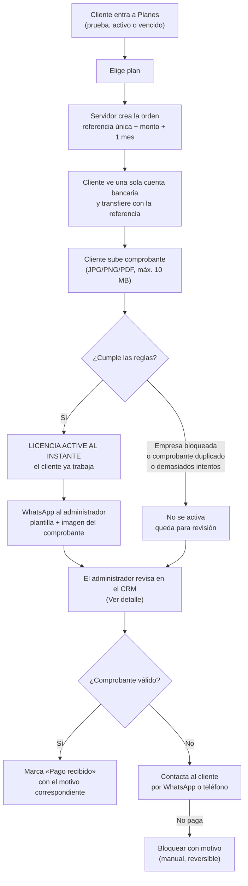

# Proceso de activación de planes

**Estado**: propuesta para acordar. No implementado.
Se apoya en el catálogo de [`05-definicion-tecnica-de-planes.md`](./05-definicion-tecnica-de-planes.md)
y en el informe original ([`00-estudio-informe-original.md`](./00-estudio-informe-original.md)),
adaptando su criterio a la decisión del propietario: **activar al recibir el comprobante y revisar
después**.

---

## 1. Decisión que cambia el criterio del informe

El informe recomendaba **no activar** hasta conciliar el abono bancario. El propietario decidió lo
contrario, y es una decisión de negocio legítima:

> **El cliente sube el comprobante y se le activa el plan al instante, en estado ACTIVE. El sistema
> avisa al WhatsApp del administrador con la imagen del comprobante. El administrador revisa, y si es
> falso o fraudulento contacta al cliente; si no paga, lo desactiva a mano.**

Lo que se mantiene del informe, porque protege al negocio:

1. La licencia queda **ACTIVE** (el cliente trabaja sin estorbos), pero el **estado del pago es
   interno** y separado: `UNCONFIRMED` hasta que el administrador lo verifique.
2. Queda en **auditoría** con orden, referencia, archivo y actor.
3. El administrador recibe **un aviso por WhatsApp** con el comprobante y los datos de la orden.
4. Puede **bloquear** la empresa en un clic y **desbloquearla** igual de rápido.

## 2. Actores

| Actor | Qué hace |
| --- | --- |
| **Cliente** (dueño o administrador de la empresa) | Elige plan, transfiere, sube comprobante, ve el estado |
| **Plataforma** | Crea la orden, valida el archivo, aplica el plan, audita |
| **Propietario / administrador comercial** | Revisa comprobantes, confirma, rechaza, suspende y reactiva |

## 3. Flujo completo

## 4. Los siete pasos, con lo que pasa exactamente

### Paso 1 — Entrar a Planes

- Puede entrar **quien está en prueba**, **quien está activo** (renovación) y **quien venció**.
- **Planes está siempre visible** en la aplicación, en cualquier estado, y siempre muestra el **estado
de la licencia** y su **fecha de vencimiento**.
- **Requisito técnico previo**: hoy una licencia vencida devuelve **401** y no deja ni iniciar sesión
  (`jwt.strategy.ts`). Hay que cambiarlo antes de que este proceso sirva: el vencido entra y solo ve
  **Planes** y **Soporte**.

### Paso 2 — Elegir plan

- La app muestra el catálogo **del servidor**, nunca precios escritos en la app.
- Cada plan muestra lo publicado: precio, usuarios, productos, almacenes, si incluye e-CF y qué nivel
  de soporte. **No** se muestran los cupos internos de e-CF.

### Paso 3 — Crear la orden

- El servidor crea una orden **inmutable** con:
  `empresa`, `plan`, `versión de catálogo`, `precio`, `meses`, `referencia`, `vence el`, `estado`.
- La **referencia la genera el servidor** (ej. `FP-2026-000123`). Es lo que el cliente escribe en la
  transferencia para poder conciliar.
- **Una sola orden abierta por empresa**: si ya hay una, se reutiliza en vez de crear otra.
- La orden se puede pagar durante **48 h**; después caduca y se crea otra.

### Paso 4 — Transferir

- Se muestra **una sola cuenta** (banco, titular, número, tipo), configurada por el propietario.
- **Si la cuenta no está configurada**, la pantalla dice «Contacta soporte para recibir los datos de
  transferencia». **Nunca** se muestran datos bancarios inventados o de ejemplo.

### Paso 5 — Subir el comprobante

Validaciones **antes** de aceptar el archivo:

| Control | Regla |
| --- | --- |
| Tipo real | Se comprueba la firma del archivo, no solo la extensión (un `.exe` renombrado a `.pdf` se rechaza) |
| Tamaño | Máximo 10 MB |
| Formatos | JPG, PNG y PDF |
| Duplicado | Se calcula el hash del archivo; si ya existe en la empresa, **no se sube otra vez** |
| Intentos | Máximo 3 subidas por día por empresa; más allá, revisión manual |
| Almacenamiento | **Privado**: nunca en la carpeta pública de `/uploads`, que hoy se sirve sin autenticación |

### Paso 6 — Activación inmediata (estado ACTIVE)

Si cumple las reglas, el servidor:

1. Marca la orden como **`EVIDENCE_RECEIVED`** y el **pago** como `UNCONFIRMED` (estado interno).
2. Aplica el **paquete del plan**: cuotas, plan y periodo.
3. Deja **apagadas** todas las funciones opcionales incluidas.
4. Pone `licenseStatus = ACTIVE` y `licenseExpiresAt = +1 mes` (o suma al vencimiento actual).
5. Registra auditoría: orden, archivo, hash, actor, plan, versión de catálogo.
6. Encola el **aviso al administrador** por WhatsApp con la imagen del comprobante.

**El cliente no ve ningún estado de espera**: entra y trabaja normalmente. Que el pago esté sin
verificar es información **interna**, no una traba para el cliente.

**No se activa** (queda para revisión) solo si:

- la empresa está **bloqueada** por fraude;
- el comprobante es **duplicado**;
- se superaron los **intentos** del día;
- el plan pedido **no existe** o está retirado.

### Paso 7 — Aviso al administrador y revisión en el CRM

Al recibir el comprobante, el sistema envía al **WhatsApp del administrador** (el número publicado,
**829-436-3936**, configurable) un mensaje con:

- Empresa, plan comprado, monto y referencia de la orden.
- Fecha y hora del envío.
- **El comprobante adjunto** (imagen o PDF).

**No se añaden botones nuevos al CRM.** Se usan los que ya existen, y cada uno pide un **motivo** de
una lista corta:

| Botón que ya existe | Motivos disponibles | Efecto en la orden |
| --- | --- | --- |
| **Activar licencia** | «Pago recibido», «Comprobante verificado», «Cortesía», «Corrección» | `SETTLED` si el motivo es de pago |
| **Reactivar manualmente** | «Pago recibido», «Bloqueo por error», «Acuerdo de pago» | `SETTLED` si el motivo es de pago |
| **Bloquear** | «Pago no confirmado», «Comprobante ilegible», «Monto incorrecto», «Fraude / sospecha», «Otro» | `UNCONFIRMED` o `REJECTED` según el motivo |
| **Desbloquear** | «Pago recibido», «Bloqueo por error» | `SETTLED` si el motivo es de pago |
| **Editar** | «Ajuste de fechas», «Ajuste de límites», «Otro» | Sin cambio de estado |
| **Eliminar** | «Baja solicitada», «Duplicado», «Otro» | `CANCELLED` |

El motivo es **obligatorio** en las acciones que cambian el estado y queda guardado en la auditoría y
en las notas de la licencia. Además se puede escribir una nota libre opcional.

Si el comprobante es falso, el administrador **contacta al cliente por fuera** (WhatsApp o teléfono) y,
si no paga, usa **Bloquear** con el motivo «Pago no confirmado» o «Fraude / sospecha». El sistema no
bloquea solo: la decisión es humana.

### Dónde se marca «pago recibido» sin botón nuevo

La licencia ya está `ACTIVE`, así que no hace falta activarla otra vez. La marca del pago se hace desde
**Ver detalle → sección Pagos**, que ya se abre con el botón existente: cada orden pendiente muestra el
comprobante y un selector con los mismos motivos («Pago recibido», «Monto incorrecto», etc.). Ese
selector actualiza el estado interno de la orden sin añadir ninguna entrada al menú.

## 5. Reglas del proceso (numeradas, para poder probarlas)

| # | Regla |
| --- | --- |
| R1 | El cliente nunca escribe precio, monto ni periodo: los pone el servidor desde el catálogo |
| R2 | Una sola orden abierta por empresa; si existe, se reutiliza |
| R3 | La orden caduca a las 48 h sin pagar |
| R4 | Una orden = **un mes** de servicio |
| R5 | Si la licencia está activa, el mes nuevo **se suma al vencimiento actual** (no se pierde tiempo) |
| R6 | Si está vencida o en prueba, el mes empieza **hoy** |
| R7 | El comprobante duplicado no activa: se vincula al expediente original |
| R8 | Una empresa **bloqueada** puede subir comprobante, pero **no se activa sola**: requiere que el administrador la desbloquee |
| R9 | La licencia queda **ACTIVE** al subir el comprobante; el estado del pago (`UNCONFIRMED`) es **interno** y no se muestra al cliente |
| R10 | Toda acción queda auditada: quién, cuándo, qué, sobre qué orden |
| R11 | El comprobante es privado: solo el cliente dueño y el administrador pueden verlo |
| R12 | Bajar de plan o marcar un pago como no confirmado **nunca borra datos** |
| R13 | Cada comprobante dispara **un aviso al WhatsApp del administrador** con la imagen y los datos de la orden |
| R14 | Si el aviso de WhatsApp falla, **la activación no se deshace**: el aviso se reintenta en la cola |
| R15 | Solo se **bloquea a mano**; ningún comprobante dudoso bloquea automáticamente |
| R16 | **No se añaden botones nuevos al CRM**: se usan los existentes y un **motivo obligatorio** clasifica el caso |
| R17 | **Planes está siempre visible**, en cualquier estado, con el estado de la licencia y su vencimiento |
| R18 | Al **vencer**, el cliente solo accede a **Planes y Soporte**, y ahí puede **pagar**; el resto queda bloqueado |
| R19 | Al cambiar de plan, la app **siempre** avisa que **no se pierden datos** |
| R20 | **Subir** de plan se aplica al momento sumando el mes al vencimiento; **bajar** se aplica en la siguiente renovación |
| R21 | El propietario puede conceder **excepciones por empresa** (más productos, más usuarios, e-CF en Básico…) con motivo y auditoría, y el cliente las ve como «Ampliación autorizada» |
| R22 | Las excepciones se aplican con el botón **Editar** de esa licencia en el CRM, sin pantalla nueva |
| R23 | Se envía **recordatorio por WhatsApp 5 días y 1 día antes** del vencimiento, con instrucciones de pago y referencia, **siempre con plantilla aprobada de Meta** |
| R24 | Cada recordatorio se envía **una vez por nivel y periodo**, en horario de atención, y **nunca desactiva** la licencia |
| R25 | Al depositar y subir el comprobante, la **renovación es automática**: se suma el mes si está activo, o empieza hoy si venció |

## 6. Qué ve el cliente

| Momento | Texto en pantalla |
| --- | --- |
| Orden creada | «Transfiere RD$2,500 a la cuenta indicada y sube tu comprobante. Referencia: FP-2026-000123» |
| Recién activado | «Tu plan está **activo** hasta el 16/12/2026.» |
| Renovación | «Renovación recibida. Tu plan está activo hasta el 16/01/2027.» |
| Bloqueado | «Tu cuenta está suspendida. Contacta soporte.» |

> El cliente **nunca** ve «pendiente de verificación»: ve **activo hasta**. La verificación es trabajo
> interno del administrador.

## 6b. Planes siempre visible y qué se permite al vencer

| Estado de la licencia | ¿Puede entrar? | Qué ve |
| --- | --- | --- |
| **Prueba** | Sí | Todo el sistema + Planes con los días de prueba que quedan |
| **Activo** | Sí | Todo el sistema + Planes con plan, estado y vencimiento |
| **Vencido** | **Sí** | **Solo Planes y Soporte**: estado, vencimiento, comparador, cuenta bancaria, subida de comprobante e historial de pagos |
| **Bloqueado** (fraude) | **No** | Pantalla de «cuenta suspendida» con la vía de contacto; sin acceso a datos del negocio |

### Qué muestra siempre la pantalla Planes

1. Nombre de la empresa y **plan actual**.
2. **Estado de la licencia**: prueba, activo, vencido o suspendido.
3. **Fecha de vencimiento** y **días restantes**.
4. **Consumo frente al límite**: usuarios, productos y almacenes.
5. **Funciones incluidas** y si están encendidas o apagadas (e-CF, impuestos, mayoreo, unidad de medida).
6. **Comparador de planes** y botón de renovar o mejorar.
7. **Cuenta bancaria** e instrucciones de pago.
8. **Subida de comprobante** y estado del último pago.
9. Acceso a **Soporte**.

> Planes **no es solo lectura**: al vencer se puede **pagar**, no solo mirar. El estado vencido
> restringe el resto del sistema, nunca el camino para regularizar.

## 6c. Tu plan: detalle, uso y cambio de plan

### Lo que muestra la pantalla cuando la empresa ya tiene plan

1. **Plan actual** con su precio y **fecha de renovación**.
2. **Uso frente al límite**, con barra y aviso al 80 %:
   «Usuarios 3 de 5», «Productos 412 de 400 (excedido)», «Almacenes 1 de 2».
3. **Qué incluye** y en qué estado: facturación electrónica, impuestos, mayoreo, unidad de medida,
   con su interruptor para encender o apagar.
4. **Ampliaciones autorizadas**, si las hay: «+200 productos autorizados por FULLTECH hasta 31/12».
5. **Cambiar de plan**, con los otros tres planes y qué cambia en cada uno.

### Botón «Cambiar de plan»

Al pulsarlo, la app **debe decir siempre** este mensaje:

> **Tus datos no se pierden.** Productos, ventas, clientes, compras, caja y configuración se conservan.
> Solo cambian los límites y las funciones incluidas.

| Movimiento | Cuándo se aplica | Qué pasa con el tiempo pagado |
| --- | --- | --- |
| **Subir** (1→2, 2→3, 3→4) | **Al momento** | Se crea una orden del plan nuevo; el mes se **suma** al vencimiento actual, así no pierde los días que le quedaban |
| **Bajar** (4→3, 3→2, 2→1) | **En la siguiente renovación** | Mantiene el plan actual hasta que venza; después se aplica el nuevo |

### Si al cambiar de plan se pasa de los límites

- **No se borra nada.** Ni productos, ni usuarios, ni almacenes.
- Se **bloquean las altas nuevas** de lo que esté por encima del límite.
- La app dice exactamente qué debe reducir: «Tienes 412 productos y tu plan permite 400. Puedes seguir
  trabajando, pero no podrás crear más hasta bajar a 400 o subir de plan».

## 6d. Recordatorios de vencimiento y renovación automática

### Recordatorios por WhatsApp al cliente

| Cuándo | Qué se envía |
| --- | --- |
| **5 días antes** del vencimiento | Mensaje con: plan, **fecha de vencimiento**, **monto**, **cuenta bancaria**, **referencia** y el aviso de que si paga hoy **no se interrumpe el servicio** |
| **1 día antes** del vencimiento | El mismo mensaje, más corto y urgente, con las mismas instrucciones de pago |

Reglas:

1. Se envía **una sola vez por nivel y por periodo** (no un recordatorio cada día).
2. La referencia sale de una **orden de renovación creada o reutilizada** al enviar el aviso, para que
   el cliente pueda transferir con ella.
3. Se envía en **horario de atención** (existe ya `notification-business-hours.util.ts`).
4. Si la empresa **no tiene teléfono**, no se envía y se registra: el recordatorio también aparece
   **dentro de la app**, en Planes.
5. Se envía por **Meta Cloud API con plantilla aprobada** (`licencia_por_vencer_5d` /
   `licencia_por_vencer_1d`), con cola de reintentos. Si WhatsApp falla, la licencia **no se toca**.

### Renovación automática al depositar

- Si el cliente **sube el comprobante antes de vencer**, el mes se **suma al vencimiento actual**:
  la licencia nunca se corta y no pierde los días que le quedaban.
- Si **sube el comprobante después de vencer**, el mes empieza **el día del pago**.
- En ambos casos la licencia queda **ACTIVE al instante**, sin esperar aprobación, y el pago queda
  `UNCONFIRMED` solo para tu control interno.
- El recordatorio de 5 días y el de 1 día **no desactivan nada**: solo avisan. La desactivación sigue
  siendo manual.

## 7. Casos límite y qué debe pasar

| Escenario | Resultado |
| --- | --- |
| Sube el comprobante antes de transferir | Se activa igual; el administrador lo ve y puede marcarlo como no recibido |
| Transfiere un fin de semana (ACH) | El cliente ya está activo; el administrador verifica cuando aparezca el abono |
| Comprobante falso o editado | El administrador lo marca como no confirmado, contacta al cliente y **bloquea a mano** si no paga |
| Sube el mismo comprobante dos veces | No se duplica: se vincula a la orden existente y no se envia dos veces el aviso |
| Dos capturas distintas del mismo pago | Se revisa a mano; el hash no las detecta |
| Sube un comprobante de otra empresa | Se detecta por empresa/orden y se rechaza |
| Monto menor al del plan | Se activa (tu decisión actual) pero se marca **monto distinto** para revisión |
| Monto mayor | Igual, marcado para revisión; el excedente lo decides tú |
| Paga dos veces el mismo mes | Dos órdenes: la segunda suma un mes más (no se pierde dinero) |
| Paga cuando ya estaba activo | Se suma al vencimiento actual |
| Sube archivo ilegible | Se rechaza con «sube una foto más clara»; no se activa |
| Se cae el servidor a mitad de la subida | La orden queda `CREATED`/`AWAITING_TRANSFER`; puede reintentar |
| El cliente cambia de plan a mitad de mes | Subir: al momento sumando el mes. Bajar: en la siguiente renovación |
| Al bajar de plan supera los límites | No se borra nada; se bloquean altas nuevas y se le dice qué reducir |
| El cliente pide más productos de los que su plan permite | Se le puede conceder una **excepción** desde el CRM (ej. +200 productos) sin cambiar de plan |
| Empresa con varias sucursales | Una sola licencia por empresa; los almacenes dependen del plan |

## 8. Seguridad del comprobante (lo que hay que construir bien)

1. **No usar `/uploads`**: ese controlador sirve archivos **sin autenticación**. Un comprobante ahí
   sería público para quien adivine la ruta.
2. Guardar en una ruta privada, con nombre aleatorio, fuera del webroot.
3. Servir el archivo por un endpoint **autenticado** y solo al dueño de la empresa o al propietario.
4. Validar el **tipo real** del archivo y el tamaño; no confiar en la extensión.
5. Registrar accesos al comprobante (quién lo vio).
6. Retención: definir cuánto tiempo se conserva (propuesta: 12 meses) y borrado posterior.

## 8b. WhatsApp por Meta Cloud API con plantillas (Evolution descartado)

**Decisión**: todas las notificaciones de licencias salen por **WhatsApp Cloud API de Meta** con
**plantillas aprobadas**. **No se usa Evolution** para este flujo.

### Lo que ya existe en el código (verificado en `origin/production-main`)

- `apps/api/src/guardian/guardian.alert.channels.ts` ya envía a
  `https://graph.facebook.com/{version}/{phoneNumberId}/messages` con `Bearer` token y
  `type: 'template'` (`template.name` + `language` + `components[body.parameters]`).
- Pero ese emisor **solo manda parámetros de body**: no soporta **cabecera con imagen o documento**.
- El módulo `notifications` general usa **Evolution** (`evolution-whatsapp.service.ts`), que queda
  fuera de este flujo.

### Lo que hay que construir

1. Un **canal Cloud API para licencias** (reutilizando el patrón de Guardian) con sus propias
   variables de entorno: `LICENSE_WA_TOKEN`, `LICENSE_WA_PHONE_NUMBER_ID`, `LICENSE_WA_VERSION`,
   `LICENSE_WA_TEMPLATE_LANG` (por defecto `es`).
2. Soporte de **cabecera con media**: subir el comprobante a
   `POST /{phoneNumberId}/media` (multipart) y enviar el template con
   `header: { type: 'image' | 'document', parameters: [{ id: mediaId }] }`.
   **No** se usan URLs públicas: el comprobante es privado.
3. Tres plantillas (categoría **Utility**), que deben estar **aprobadas en Meta Business Manager**
   antes de que nada se envíe:

| Plantilla | Para | Variables |
| --- | --- | --- |
| `licencia_por_vencer_5d` | Cliente, 5 días antes | `{{1}}` empresa · `{{2}}` fecha de vencimiento · `{{3}}` monto · `{{4}}` referencia |
| `licencia_por_vencer_1d` | Cliente, 1 día antes | Igual, con texto más urgente |
| `licencia_pago_por_verificar` | Administrador, al recibir comprobante | **Cabecera imagen/documento** + `{{1}}` empresa · `{{2}}` plan · `{{3}}` monto · `{{4}}` referencia |

4. Los **textos de las plantillas los aprueba Meta**: hay que crearlas y esperar la aprobación (suele
   tardar de minutos a un día). Sin plantilla aprobada, **el envío falla** y el sistema no debe activar
   ni desactivar nada por eso.

### Reglas de Cloud API que hay que respetar

- **Fuera de la ventana de 24 horas solo se puede escribir con plantilla aprobada.** Los recordatorios
  y el aviso al administrador son mensajes iniciados por el negocio: **siempre plantilla**.
- El texto libre (`type: 'text'`) solo vale si el cliente escribió en las últimas 24 h. Por eso el
  emisor de Guardian, que cae a texto si no hay plantilla, **no sirve tal cual** para este flujo.
- El número destino debe estar en formato internacional sin `+` (ej. `18294363936`) y tener WhatsApp.
- Las **variables no pueden ir vacías**: si a una empresa le falta un dato, se usa un valor por
  defecto o no se envía.
- Las plantillas **Utility** tienen costo por conversación. El aviso al administrador y los
  recordatorios se facturan: hay que tenerlo en cuenta.
- WhatsApp exige **opt-in** del cliente para mensajes iniciados por el negocio. Conviene incluirlo en
  los términos del servicio y ofrecer baja.
- Si la API falla o la plantilla no está aprobada, **la licencia no se toca**: se reintenta y se
  registra el error.

### Alternativa si no hay plantillas aprobadas todavía

El aviso dentro de la app (Planes y Soporte) funciona igual. La WhatsApp es un **extra**, no un
requisito para activar o renovar.

## 9. Lo que hay que construir (orden técnico)

| # | Pieza | Sin esto… |
| --- | --- | --- |
| 1 | Entrada restringida al vencer (Planes + Soporte) | El cliente vencido no puede ni entrar a pagar |
| 2 | Catálogo de planes en servidor | No hay precios ni cuotas que aplicar |
| 3 | Órdenes + referencias | No hay a qué asociar el comprobante |
| 4 | Subida privada de comprobantes | No hay prueba del pago |
| 5 | Activación al subir + auditoría | No se cumple la decisión del propietario |
| 5b | **Cloud API de Meta** con plantilla `licencia_pago_por_verificar` (cabecera con la imagen) | El administrador no se entera del pago |
| 5c | Recordatorios al cliente 5 días y 1 día antes, con instrucciones y referencia | El cliente se entera cuando ya está cortado |
| 5d | Renovación automática al subir comprobante (suma al vencimiento) | Habría que reactivar a mano cada mes |
| 6 | CRM: **los mismos botones** con selector de motivo obligatorio + sección Pagos en Ver detalle | No puedes clasificar el caso ni suspender con criterio |
| 7 | Actualizar la web (precios, Negocio 1 almacén, e-CF de Básico) | Web y producto dirían cosas distintas |

## 10. Decisiones que necesito para cerrar el proceso

> **Actualización 2026-11-16**: el propietario no estaba disponible; **A-1 a A-19 se adoptan tal como
> están propuestas y son revisables**. El plan definitivo está en
> [`07-plan-implementacion.md`](./07-plan-implementacion.md).

| # | Pregunta | Mi propuesta |
| --- | --- | --- |
| **A-1** | ¿La orden caduca a las 48 h? | Sí |
| **A-2** | ¿Una orden = un mes, o el cliente elige cuántos meses paga? | Un mes |
| **A-3** | Si está activo y renueva, ¿el mes se suma al vencimiento actual? | Sí, no se pierde tiempo |
| **A-4** | Si el comprobante es inválido, ¿bloqueo automático o manual? | **Manual**: tú contactas y bloqueas con el motivo correspondiente |
| **A-5** | ¿Máximo 3 comprobantes por día? | Sí |
| **A-6** | ¿Una empresa **bloqueada** puede subir comprobante (sin activarse sola)? | Sí, requiere que la desbloquees |
| **A-7** | ¿Cambio de plan a mitad de mes? | **Subir al momento** (mes sumado) · **bajar en la siguiente renovación** |
| **A-8** | ¿Cuánto tiempo se guardan los comprobantes? | 12 meses |
| **A-9** | ¿El aviso va al **829-436-3936**? | Sí, configurable por variable de entorno |
| **A-10** | ¿El aviso incluye la **imagen** o solo los datos? | Incluye imagen/PDF + datos de la orden |
| **A-11** | ¿Un cliente **bloqueado** puede entrar a ver Planes/Soporte, o queda fuera? | Queda fuera: es el botón de fraude; el administrador desbloquea o da soporte |
| **A-12** | ¿Las excepciones se **suman** al plan o lo sustituyen? ¿Caducan? | Se **suman**; caducidad opcional |
| **A-13** | ¿Quién puede conceder excepciones? | Solo el propietario desde el CRM, con motivo y auditoría |
| **A-14** | ¿A qué número se envían los recordatorios al cliente? | Al teléfono del **propietario de la empresa**; si no hay, al teléfono de la empresa |
| **A-15** | ¿A qué hora se envían los recordatorios? | En horario de atención (9:00 a 18:00) |
| **A-16** | ¿Se añade un tercer recordatorio el día del vencimiento? | No por ahora; si lo quieres, se añade |
| **A-17** | Las tres plantillas hay que crearlas y **aprobarlas en Meta Business Manager** | Crearlas con los textos de §8b; sin aprobación no se envía nada |
| **A-18** | ¿Categoría de las plantillas? | **Utility** (son avisos de servicio, no publicidad) |
| **A-19** | ¿Se pide consentimiento al cliente para estos avisos? | Sí, incluirlo en los términos y dar opción de baja |
