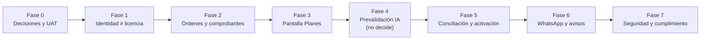

# Planes de pago y administración de licencias

Rama de trabajo: `agent/planes-de-pago-20261116` (worktree `C:\src\fullpos-planes-de-pago-20261116`,
base `production-main` @ `6b3e38ed`).

Este directorio contiene **el estudio** de la estrategia y **el plan maestro** para implementarla.
No contiene todavía código: la estrategia original dice explícitamente que el informe es
diagnóstico y **no** autorización de edición, y que el paso siguiente es este Plan Maestro.

## Documentos

| Archivo | Qué es | Estado |
| --- | --- | --- |
| [`fuentes/`](./fuentes) | PDF original (07-nov-2026) + texto extraído, para trazabilidad | — |
| [`00-estudio-informe-original.md`](./00-estudio-informe-original.md) | Estudio fiel del informe: decisiones, tablas, criterios y veredicto | Estudiado |
| [`01-inventario-tecnico-verificado.md`](./01-inventario-tecnico-verificado.md) | Lo que existe **hoy** en el código, comprobado con comandos (y lo que no existe) | Verificado en `6b3e38ed` |
| [`02-plan-maestro-implementacion.md`](./02-plan-maestro-implementacion.md) | Fases, archivos exactos, pruebas, riesgos y criterios de salida | Propuesto |
| [`03-decisiones-pendientes.md`](./03-decisiones-pendientes.md) | Decisiones de negocio que bloquean la implementación | Pendiente del propietario |
| [`04-catalogo-oficial-planes.md`](./04-catalogo-oficial-planes.md) | **Catálogo publicado en la web**, beneficio por beneficio, y qué es aplicable hoy | Verificado contra producción |
| [`05-definicion-tecnica-de-planes.md`](./05-definicion-tecnica-de-planes.md) | **Paquete técnico de cada plan**: cuotas, interruptores y qué se aplica al activar | Propuesta para revisar |
| [`06-proceso-de-activacion.md`](./06-proceso-de-activacion.md) | **Cómo se activa**: flujo, estados, reglas, casos límite y seguridad del comprobante | Propuesta para acordar |
| [`07-plan-implementacion.md`](./07-plan-implementacion.md) | **Cómo se construye**: base de datos, API, Flutter, web, orden de PRs y pruebas | Listo para ejecutar || [`08-arquitectura-verificada-real.md`](./08-arquitectura-verificada-real.md) | **Corrección**: APPYRA administra planes y overrides; el CRM ya tiene los botones; la cadena real | Verificado en código |
| [`09-auditoria-completa.md`](./09-auditoria-completa.md) | **Auditoría** de APPYRA y del backend de licencias: 170 endpoints, tablas, flujos y 10 hallazgos | Verificado en código |
## Regla de lectura

- **HECHO**: verificado en el código de esta rama con un comando concreto (se cita en el documento).
- **HIPÓTESIS**: deducido de la auditoría incluida en el informe, no comprobado aquí.
- **DECISIÓN PENDIENTE**: requiere al propietario; no la toma el agente.

Ninguna fase se declara terminada por compilar: cada una exige las pruebas de su sección y, cuando
hay pantalla, evidencia visual real (captura + interacción).

## Orden de ejecución recomendado

La Fase 1 (separar identidad de licencia) va **antes** que la pantalla: sin ella el cliente vencido
no puede ni entrar a pagar.

## Dónde se implementa

El código de esta estrategia se escribe en **`C:\src\fullpos-planes-de-pago-impl`**, rama
`agent/planes-de-pago-impl-20261116`, creada desde **`origin/production-main` (`e6e7e8fc`)**.

La carpeta anterior (`C:\src\fullpos-planes-de-pago-20261116`) queda como archivo histórico: nació de
una `production-main` local 399 commits atrás y **no** se usa para implementar.

## Migraciones y seed

- `start-prod.sh` ejecuta **`prisma migrate deploy` al arrancar** (`RUN_MIGRATIONS=true` por defecto):
  no hay que aplicar migraciones a mano.
- Ojo: `MIGRATION_STRICT` viene en **`false`**; si una migración falla, la API arranca igual.
- El catálogo de planes **no se siembra solo**: hay que ejecutar una vez
  `scripts/seed-license-plans.ts` (idempotente).
